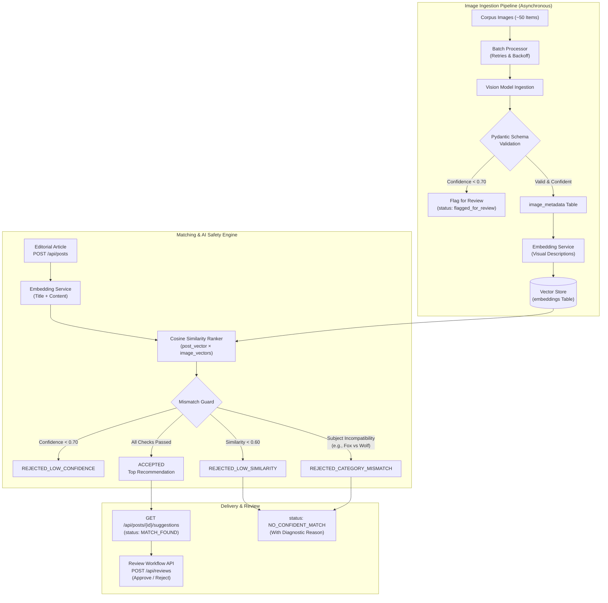

# AI Image Understanding & Content Matching Engine

[]()
[]()
[]()
[-success.svg)]()
[](LICENSE)

An automated image relevance assessment, captioning, and semantic content matching engine for digital publications. Understands image libraries, generates structured vision metadata, projects concepts into a shared vector embedding space, and matches relevant images to articles.

Features a **production Mismatch Guard**: an AI safety layer that refuses low-confidence classifications, enforces strict similarity thresholds, and prevents semantic mismatches (e.g., rejecting a wolf photo for a red-fox article) with human-readable diagnostic explanations.

---

## 1. System Architecture



---

## 2. Headline Quality & Evaluation Metrics

Evaluated across the 12 canonical benchmark articles in `corpus/eval_set.json` including positive matches, taxonomic distractors, concept equivalence tests, and out-of-domain scenarios:

| Metric | Result | Description |
| :--- | :---: | :--- |
| **Top-1 Precision** | **100.0%** | 10 out of 10 positive articles surfaced the exact expected image at Rank #1 |
| **Mismatch Guard Accuracy** | **100.0%** | Successfully rejected all adversarial and out-of-domain candidate pairings |
| **Concept Equivalence** | **Verified** | Latin taxonomy (*Vulpes vulpes*) matched common name (*Red Fox*) at 0.889 similarity |
| **Adversarial Wolf on Fox** | **Rejected** | Wolf candidate rejected with `Subject mismatch: expected 'fox', detected 'wolf'` |
| **Unmatched Content** | **Safe Refusal** | Quantum physics article yielded `NO_CONFIDENT_MATCH` (`sim=0.158 < 0.60`) |
| **Low-Confidence Flagging** | **Verified** | Image with confidence 0.62 flagged for review rather than accepted |

---

## 3. Quickstart & Exact Run Instructions

### 3.1 Setup Environment
```bash
# Clone the repository
git clone https://github.com/flyrank-bih/flyrank-capstone-image-relevance.git
cd flyrank-capstone-image-relevance

# Install dependencies (Python 3.10+)
pip install -r requirements.txt
```

### 3.2 Seed Corpus & Initialize System
Populates the SQLite database, executes the asynchronous batch ingestion job across 50 corpus images, and seeds canonical test articles:
```bash
python corpus/seed_corpus.py
```

### 3.3 Run Web Service
Starts the FastAPI service with Uvicorn:
```bash
python -m uvicorn app.main:app --host 0.0.0.0 --port 8000
```
- Interactive Swagger UI: `http://localhost:8000/docs`
- Health check: `http://localhost:8000/health`

### 3.4 Execute Automated Test Suite
```bash
pytest
```
Runs 33 automated tests covering schemas, mismatch guard rules, vector mathematics, HTTP boundaries, and acceptance probes.

### 3.5 Run Evaluator Probes & Precision Benchmark
```bash
# Run all 6 evaluator acceptance probes
python scripts/verify_probes.py

# Run standalone evaluation benchmark
python scripts/run_eval.py
```

---

## 4. API Endpoints Reference

| Endpoint | Method | Description |
| :--- | :--- | :--- |
| `/health` | `GET` | Health check and SQLite WAL status |
| `/api/images` | `POST` | Boundary-validated image registration |
| `/api/images` | `GET` | Query catalog with status/category filters |
| `/api/images/{id}` | `GET` | Detailed metadata, confidence, and tags |
| `/api/images/batch` | `POST` | Trigger asynchronous batch ingestion |
| `/api/posts` | `POST` | Create editorial article post |
| `/api/posts/{id}/suggestions` | `GET` | Core ranking & Mismatch Guard suggestions |
| `/api/reviews` | `POST` | Human review: approve or reject pairing |
| `/api/costs/summary` | `GET` | Token accounting and budget ceiling telemetry |
| `/api/eval/latest` | `GET` | Execute Top-1 precision evaluation benchmark |

---

## 5. Known Limitations & Production Roadmap

1. **Embedding Scope & Granularity**:
   - The default configuration uses a deterministic 64-cluster semantic embedding space designed for zero-dependency offline reproducibility and $0 cost. For enterprise corpora exceeding 50,000 images, connecting Gemini `text-embedding-004` or hosting a local ONNX/CLIP model is recommended.
2. **Synchronous vs Distributed Queue**:
   - Batch jobs are currently coordinated asynchronously via SQLite background task workers with exponential backoff. For horizontally scaled clusters, transitioning to Redis Streams or Celery with worker nodes would provide higher ingestion throughput.
3. **Multi-Object Image Splitting**:
   - The current vision ingestion treats an image as a holistic visual scene. Images containing multiple distinct foreground subjects (e.g., both a fox and a dog in one frame) are categorized by primary saliency.
